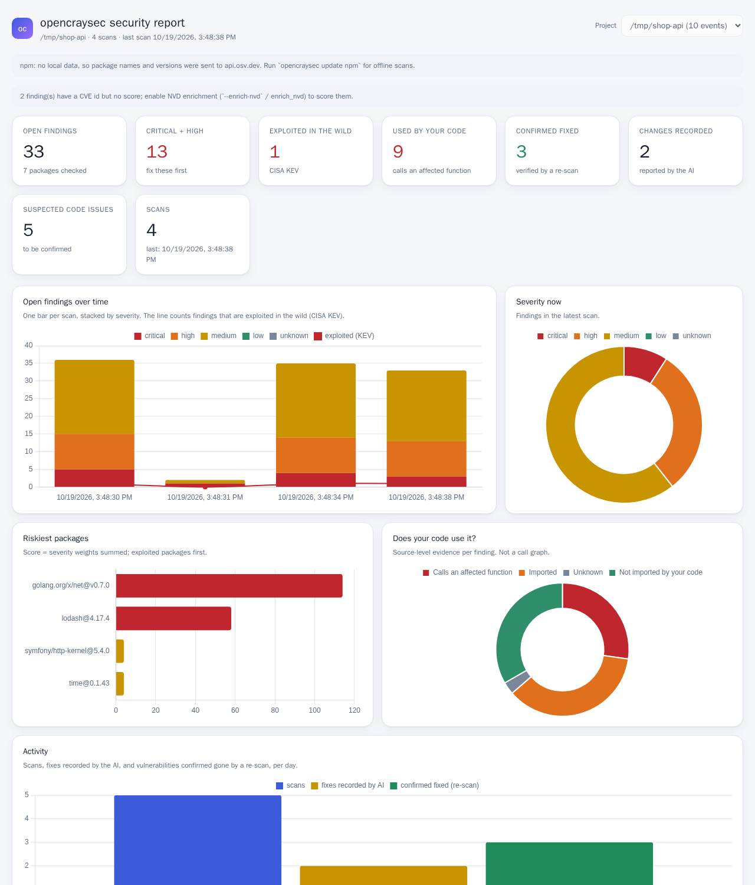
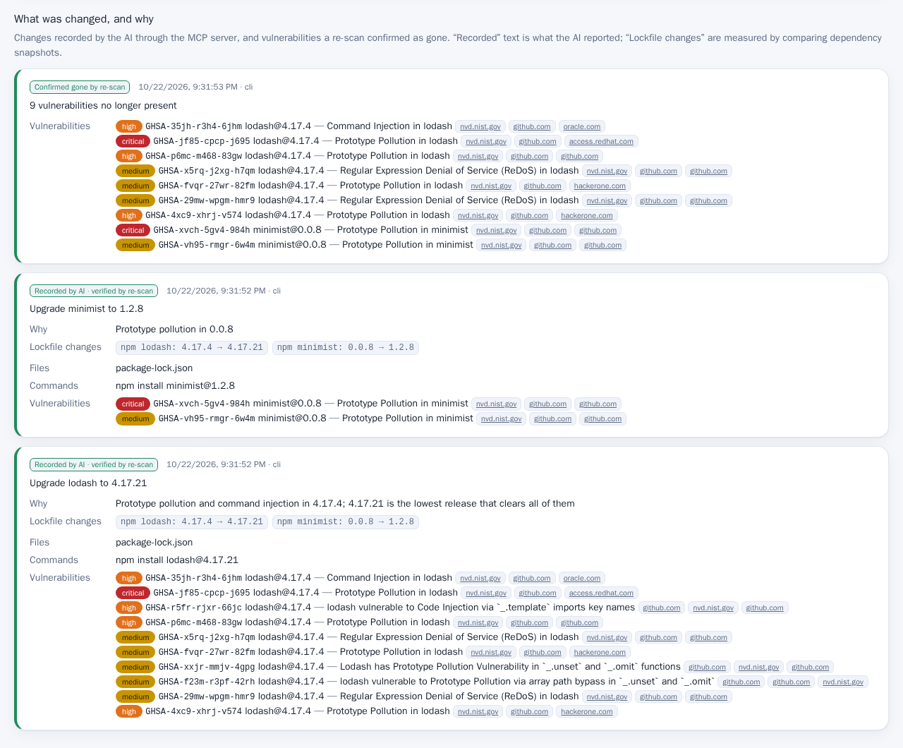

# opencraysec — current vulnerability data for your coding agents

[](https://github.com/amgio38/opencraysec/actions/workflows/ci.yml)
[](https://github.com/amgio38/opencraysec/actions/workflows/audit.yml)
[](LICENSE)
[](https://github.com/amgio38/opencraysec/releases/latest)

A model's training data is months old. Advisories are published every day. `opencraysec` gives your
AI assistant (or you, on the command line) a fast way to check a project's dependencies against
**today's** public advisories, rank what matters, say whether your own code uses the vulnerable
package, and prove a fix worked. Every scan, fix and verification is logged, so you can see what the
assistant changed, and why, in a dashboard.

One static binary. An MCP server and a CLI. No account, no API key, and your source code never leaves
your machine.

**What you get**

- **Many languages**: Rust, JavaScript/TypeScript, PHP, Go and Python lockfiles.
- **Current, public data only**: [OSV](https://osv.dev) (which aggregates GitHub Advisories, RustSec,
  the Go vulnerability database and more), the CISA *Known Exploited Vulnerabilities* list, FIRST EPSS
  scores, the MITRE CWE catalog and NVD scores. CVE ids, CWE weakness classes and CVSS come with the
  advisories. See [docs/DATA-SOURCES.md](docs/DATA-SOURCES.md).
- **Ranked, not just listed**: exploited in the wild first, then likely to be exploited, then CVSS.
- **Is it actually used?** Usage evidence per finding from your own source: for Rust and Go down to the
  affected function. Findings your code does not import sink in the ranking (never hidden).
- **Fix, verify, record**: `plan_fix` gives the exact upgrade commands, `verify_fix` re-scans and tells you
  which advisories are gone, `record_fix` logs what was changed and why, like a commit message. An id is
  `resolved` only when an earlier scan of the same path reported it; an id no earlier scan reported is
  `unknown`, and that proves nothing.
- **Your own code too**: `scan-code` flags suspected hard-coded secrets, injection patterns, disabled TLS
  verification and unsafe deserialization, each with a CWE, and can run gitleaks or semgrep.
- **A report people can read**: a read-only dashboard with charts, the vulnerability list and the history
  of fixes with references, or the same report as one HTML file.
- **Honest**: every result says what was scanned, what was not, and how old the data is. A clean result
  means *no known advisory matched*, not *secure*.

## See it in action

<p align="center">
  
</p>

<p align="center">
  
</p>

> Both images come from a scratch project (`/tmp/shop-api`) with real advisory data; no customer data
> or personal paths are shown.

## Install in 30 seconds

```sh
curl -fsSL https://raw.githubusercontent.com/amgio38/opencraysec/main/scripts/install.sh | sh
opencraysec update --for .          # download advisories for the ecosystems in this project
opencraysec scan .                  # and check it
claude mcp add opencraysec -- opencraysec mcp
```

| Platform | How |
| --- | --- |
| Linux x86-64, aarch64 | The command above downloads a prebuilt static binary and checks its SHA-256. No Rust needed. |
| macOS, Apple Silicon and Intel | The same command downloads a prebuilt native binary and checks its SHA-256. No Rust or Xcode needed. |
| Other Linux CPUs | The same command builds from source (Rust 1.95+ and a C compiler). |
| Windows | Run it inside **WSL2** (below). The installer refuses native Windows shells. |

A prebuilt binary for every supported platform is attached to each [release](https://github.com/amgio38/opencraysec/releases), with a `.sha256` file beside it; [docs/INSTALL.md](docs/INSTALL.md) shows how to verify a download by hand.

The first line installs `opencraysec` into `~/.local/bin`. Other clients (Cursor, opencode, Codex),
system-wide installs and uninstalling are in [docs/INSTALL.md](docs/INSTALL.md) and
[docs/CLIENTS.md](docs/CLIENTS.md).

To teach the assistant the workflow, install the bundled
[Agent Skill](skills/opencraysec/SKILL.md): copy it once for every project, or into this project only.

```sh
cp -r skills/opencraysec ~/.claude/skills/   # every project
cp -r skills/opencraysec .claude/skills/     # this project only
```

### Windows (WSL2)

From PowerShell, once (this installs Ubuntu and asks for a reboot):

```powershell
wsl --install -d Ubuntu
```

Then open the **Ubuntu** app and install exactly as on Linux:

```sh
curl -fsSL https://raw.githubusercontent.com/amgio38/opencraysec/main/scripts/install.sh | sh
```

Run your coding agent inside WSL as well, and keep your projects on the Linux side
(`~/projects`, not `/mnt/c/...`): the lockfiles are then read at native speed, and the paths the
tools report match what the agent sees.

## Use it

```sh
opencraysec scan .                       # human-readable report, most urgent first
opencraysec scan . --format sarif -o out.sarif      # also: json, cyclonedx (SBOM)
opencraysec scan . --fail-on high        # exit 1 in CI if anything is high or worse, 3 if nothing was checked
opencraysec scan . --enrich-nvd          # score findings the advisories left unscored
opencraysec explain GHSA-xxxx-xxxx-xxxx  # what it is, how bad, references
opencraysec plan-fix .                   # the upgrade commands; nothing is modified
opencraysec verify-fix . --id GHSA-xxxx-xxxx-xxxx   # re-scan; "resolved" needs an earlier scan of this path
opencraysec record-fix . --id GHSA-xxxx-xxxx-xxxx --summary "Upgrade lodash" --reason "Prototype pollution"
opencraysec scan-code .                  # suspected weaknesses in your own source
opencraysec dashboard                    # the report on http://localhost:1787
opencraysec report -o report.html        # the same report as one file
opencraysec status                       # what data is stored, and how old
```

`scan` works without downloading anything: for an ecosystem with no local data it asks the OSV API about
the exact package names and versions it found (never your code) and says so in the report. `--offline`
forbids that. Run `update` once for fully offline scans.

`scan --fail-on` exits 1 when it found something at or above the threshold, and 3 when a pass would prove
nothing: no lockfile, an unreadable lockfile, an ecosystem with no advisory data, or only requirement lines
without an exact `==` pin. Requirement lines listed next to dependencies that were checked do not fail the
gate; the report then says it is incomplete. `verify-fix` exits 1 when a finding remains, an id is
`unknown`, or the result could not be trusted. The full table is in
[docs/CONFIGURATION.md](docs/CONFIGURATION.md#exit-codes).

## MCP server

```json
{
  "mcpServers": {
    "opencraysec": { "command": "opencraysec", "args": ["mcp", "--workspace", "/path/to/project"] }
  }
}
```

| Tool | Purpose |
| --- | --- |
| `scan_dependencies` | Check lockfiles against current advisories, ranked, with usage evidence. |
| `scan_code` | Suspected weaknesses in the project's own source. |
| `explain_advisory` | One advisory: what it is, CWE, exploitation signals, references. |
| `plan_fix` | The minimal upgrades and the commands to run. Modifies nothing. |
| `verify_fix` | Re-scan and prove advisories are gone (and whether that proof can be trusted). |
| `record_fix` | Optional, like a commit message: what the assistant changed and why. |
| `update_db` | Download or refresh the advisory data. |
| `db_status` | What data is stored, and how old it is. |

Paths are confined to `--workspace`. The server never edits your project: it tells the assistant what to
run, and `record_fix` writes only to the activity log. Full arguments and results are in
[docs/TOOLS.md](docs/TOOLS.md).

## The dashboard

`opencraysec dashboard` serves a read-only report from the activity log: counts, severity over time, the
riskiest packages, usage evidence, activity, the vulnerable dependencies, suspected code issues, and the
history of what was changed and why.

**It listens on every network interface by default (`0.0.0.0:1787`) and the report lists your
vulnerabilities.** Use `--host 127.0.0.1` to keep it on this machine, or `--token SECRET` to require one.
Details, including what the log holds, are in [docs/DASHBOARD.md](docs/DASHBOARD.md).

## Limits

- Dependency matching uses **lockfile versions**. Usage evidence is **source text**, not a call graph: it
  can miss dynamic use and cannot see use by other dependencies, so `not_found` means "your code does not
  import it", not "safe". For Go, run `govulncheck` for a call-graph proof.
- `scan-code` is pattern matching with a small rule pack. Every hit is *suspected*; confirm it before
  reporting.
- A `requirements.txt` entry without an exact `==` pin cannot be matched. CVSS v4 vectors are not
  computed locally; `--enrich-nvd` fetches NVD's score.
- The activity log is not rotated.

## Privacy

Scanning is local. The only network traffic is downloading public datasets (OSV, CISA, FIRST, MITRE),
querying `api.osv.dev` with package names and versions when an ecosystem has no local data and you did
not pass `--offline`, and NVD lookups by CVE id when you pass `--enrich-nvd`. The activity log holds
package names, versions, advisory ids and file paths, never source code or secrets, and stays on your
machine. See [docs/CONFIGURATION.md](docs/CONFIGURATION.md#network-use).

## Documentation

| | |
| --- | --- |
| [docs/INSTALL.md](docs/INSTALL.md) | Installing, building, uninstalling, verifying a download |
| [docs/CLIENTS.md](docs/CLIENTS.md) | Claude Code, Cursor, opencode, Codex and any other MCP client |
| [docs/TOOLS.md](docs/TOOLS.md) | Every MCP tool, its arguments and results |
| [docs/LANGUAGES.md](docs/LANGUAGES.md) | Supported lockfiles, usage evidence, fix commands, code rules |
| [docs/DASHBOARD.md](docs/DASHBOARD.md) | The report, the log, and who can see them |
| [docs/DATA-SOURCES.md](docs/DATA-SOURCES.md) | Where every fact comes from, and how findings are ranked |
| [docs/CONFIGURATION.md](docs/CONFIGURATION.md) | Data directory, environment variables, limits, exit codes |
| [docs/TROUBLESHOOTING.md](docs/TROUBLESHOOTING.md) | Common problems |
| [docs/ARCHITECTURE.md](docs/ARCHITECTURE.md) | How the crates fit together and why |
| [docs/RELEASING.md](docs/RELEASING.md) | How a release is cut |

## Repository layout

| Crate | Role |
| --- | --- |
| `opencraysec-core` | Package model, per-ecosystem version ordering, CVSS v3, OSV matching. |
| `opencraysec-lockfile` | Lockfile discovery and parsers. |
| `opencraysec-db` | Local store, dataset updates, the OSV and NVD clients. |
| `opencraysec-engine` | Scan, usage evidence, code rules, explain, plan and verify fix, SARIF and CycloneDX. |
| `opencraysec-log` | The activity log (JSONL), dependency snapshots and report summaries. |
| `opencraysec-web` | The read-only dashboard server and the HTML export. |
| `opencraysec-mcp` | The MCP stdio server. |
| `opencraysec-cli` | The `opencraysec` binary. |

Build and test with `make ci` (format, clippy, tests, layering, licence, installer and docs checks) and
`make preflight` before every push (the same list CI runs, plus the 90% coverage gate). See
[CONTRIBUTING.md](CONTRIBUTING.md) for the conventions.

## License

MIT. See [LICENSE](LICENSE) and [SECURITY.md](SECURITY.md).

Dependencies are under their own licenses: see [THIRD-PARTY-LICENSES.md](THIRD-PARTY-LICENSES.md) for the
crate-by-crate inventory and [NOTICE](NOTICE) for the required attributions. The licence texts those
require are in [`licenses/`](licenses/). `deny.toml` is the policy and `make deny` is the gate; CI runs it
on every push. The vulnerability data opencraysec downloads belongs to its publishers; see
[docs/DATA-SOURCES.md](docs/DATA-SOURCES.md).

An installed copy carries all of it: `install.sh` and `make install` put this set under
`$PREFIX/share/doc/opencraysec`, the release archive carries it so there is something to install, and
both uninstall paths remove it.

The crates in this workspace are marked `publish = false` in their `Cargo.toml`. That is deliberate:
they are released as the `opencraysec` binary, not as a library for others to depend on. It also means
`cargo install opencraysec` from crates.io does not work and is not intended; use the installer above, or
build from a checkout with `cargo build --release -p opencraysec-cli`.
